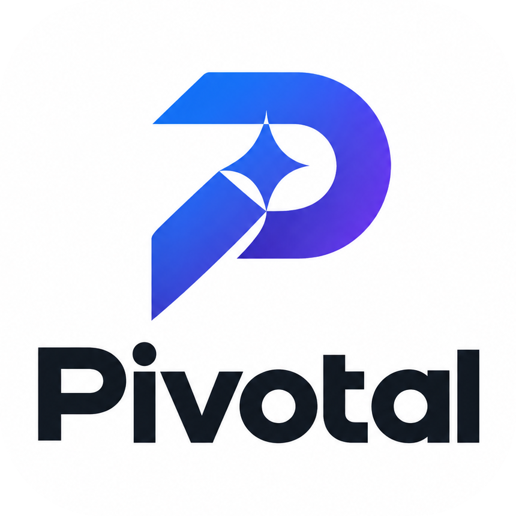

  

<h1 align="center">Pivotal</h1>

  <strong>A portable, single-file AI coding instruction system for reliable, token-efficient pair programming.</strong>

---

## Overview

Pivotal is a lightweight, agent-agnostic instruction system designed to optimize how AI coding assistants interact with your codebase. By placing a single `AGENTS.md` file into the root of any repository, Pivotal establishes clear operational guardrails that guide agents to understand developer intent accurately, avoid unnecessary context exploration, produce minimal and maintainable changes, and verify results before declaring completion.

Pivotal requires no package installations, runtime daemons, API integrations, build tools, or configuration flags.

## Problems Pivotal Solves

Modern AI coding agents frequently encounter friction patterns that degrade output quality and consume excessive tokens:

- **Unsolicited Refactoring & Scope Creep**: Agents rewrite untouched code, invent requirements, or overcomplicate simple fixes.
- **Aimless Exploration**: Agents perform repetitive directory walks and read unrelated files before understanding available context.
- **Circular Reasoning Loops**: Agents repeatedly execute failing commands without diagnosing the underlying root cause.
- **Overengineered Solutions**: Agents introduce unwarranted abstractions, design patterns, or new dependencies for simple requests.
- **Unverified Completion**: Agents report that work is finished without running available tests, builds, or type checks.

## Core Principles

Pivotal instills six operational disciplines into AI agents:

1. **Understand First**: Identify the user's objective, evaluate existing context, and distinguish hard requirements from assumptions. Clarify only when missing details materially impact correctness or safety.
2. **Think Efficiently**: Use existing context before conducting exploratory searches. Inspect only files relevant to the task, minimizing redundant commands and excessive token consumption.
3. **Execute Directly**: Proceed immediately to implementation on well-defined tasks. Prefer the simplest maintainable solution, keep changes targeted, and preserve existing project architecture.
4. **Verify Before Done**: Execute available linters, tests, and builds before claiming task completion. Report verified outcomes and unverified limitations honestly.
5. **Adapt to Complexity**: Apply simple, direct changes to simple tasks; reserve structured multi-step plans for complex implementations and evidence-driven debugging.
6. **Respect User Intent**: Prioritize explicit user goals and project conventions above agent preferences, while strictly upholding safety and policy boundaries.

### Adaptive Operational Rhythm

Agents follow an adaptive, proportional progression:

$$\text{Understand} \longrightarrow \text{Inspect} \longrightarrow \text{Prioritize} \longrightarrow \text{Execute} \longrightarrow \text{Verify} \longrightarrow \text{Report}$$

This workflow functions as an internal operating discipline rather than a rigid, visible checklist for trivial edits.

## Key Features

- **Single-File Deliverable**: Everything needed to guide an AI agent is contained in a standalone `AGENTS.md`.
- **Solution-Priority Ladder**: Guides agents to evaluate no-change options, existing code, standard libraries, and platform features before writing new code.
- **Zero Dependencies**: No npm packages, Python modules, CLI tools, external APIs, or background processes required.
- **Agent-Native Instructions**: Formatted in concise, imperative Markdown optimized for prompt ingestion and agent reasoning.
- **Blast Radius Control**: Prevents unwanted styling sweeps, file reorganizations, and speculative generalizations.
- **Proportional & Evidence-Driven Verification**: Instructs agents to provide verifiable proof of execution rather than assumptions of correctness.
- **Clear Stopping Conditions**: Enforces bounded task completion without runaway speculative modifications.

## Quick Start

Using Pivotal requires four straightforward steps:

1. Open the **Pivotal** repository.
2. Copy `AGENTS.md`.
3. Paste `AGENTS.md` into the root directory of your target coding project.
4. Start or continue working with your compatible AI coding agent.

No repository cloning, package installations, environment variables, or build steps are necessary.

## Compatibility

Pivotal is designed to work with AI coding agents and development environments that support workspace-level instruction files (such as `AGENTS.md`).

- **Direct Support**: Compatible with agents that automatically ingest `AGENTS.md` at workspace initialization (e.g., Cursor, GitHub Copilot Workspace, Windsurf, Claude Code, Gemini Code Assist, Codex-based assistants).
- **Alternative Conventions**: If your development tool expects a different instruction file name (such as `.cursorrules`, `CLAUDE.md`, or `.github/copilot-instructions.md`), the contents of `AGENTS.md` can be placed into or imported by that tool's designated file.
- **Compatibility Boundaries**: AI coding tools differ in how they parse, prioritize, and adhere to workspace instructions. Pivotal does not claim universal compatibility across every existing platform or tool configuration.

## Limitations

- **Model Capabilities**: Pivotal provides instructions; it cannot alter the underlying foundational weights, training data, or native token pricing of third-party AI models.
- **Agent Compliance**: Effectiveness depends on the target agent's instruction-following compliance. If an agent ignores workspace-level instructions, Pivotal cannot force execution.
- **Environment Verification**: Verification commands (such as tests or linters) can only be executed if appropriate tooling and test suites exist within the target project environment.

## License

Pivotal is licensed under a custom proprietary license. See the [LICENSE](LICENSE) file for complete legal terms, usage rights, and restrictions.

